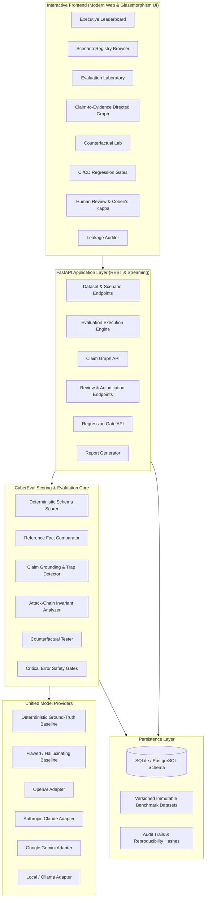

<p align="center">
  
  <h1 align="center">🛡️ CyberEval</h1>
  <p align="center">
    <strong>Production-Grade, Evidence-Grounded AI Evaluation Platform for Cybersecurity</strong>
  </p>
  <p align="center">
    <em>Measuring whether AI systems can reason accurately about cybersecurity incidents — not merely whether their answers sound convincing.</em>
  </p>
</p>

<p align="center">
  <a href="https://opensource.org/licenses/MIT"></a>
  <a href="https://www.python.org/downloads/"></a>
  <a href="https://fastapi.tiangolo.com/"></a>
  <a href="https://docs.pytest.org/"></a>
  <a href="https://www.docker.com/"></a>
</p>

---

## 📖 Table of Contents
1. [What is CyberEval?](#-what-is-cybereval)
2. [Why CyberEval? (Competitive Landscape)](#-why-cybereval-competitive-landscape)
3. [Six Signature Innovations](#-six-signature-innovations)
4. [The Eight Core Modules](#-the-eight-core-modules)
5. [Multi-Layer Scoring Methodology](#-multi-layer-scoring-methodology)
6. [System Architecture](#-system-architecture)
7. [Installation & Getting Started](#-installation--getting-started)
8. [Command-Line Interface (CLI) & CI/CD Automation](#-command-line-interface-cli--cicd-automation)
9. [REST API Documentation](#-rest-api-documentation)
10. [Open Source Benchmark Registry](#-open-source-benchmark-registry)
11. [Security & Production Hardening](#-security--production-hardening)
12. [Contributing & Development](#-contributing--development)
13. [License](#-license)

---

## 🌟 What is CyberEval?

**CyberEval** is an open-source, benchmark-driven quality assurance and evaluation platform built specifically for cybersecurity AI. 

In high-consequence technical domains like cybersecurity, an AI model that generates plausible-sounding yet ungrounded explanations is dangerous. If an AI misses a critical lateral movement step, invents a data exfiltration event that never occurred, misclassifies a MITRE ATT&CK technique, or recommends disabling security controls, the defensive posture of an entire organization is compromised.

CyberEval tests AI security assessments against **verified forensic telemetry** (Sysmon, Zeek, AWS CloudTrail, Linux auditd, Okta auth, EDR memory logs), **structured reference answers**, **topological graph constraints**, and **calibrated human expert review**.

### The Six Questions CyberEval Answers:
1. **Factual Correctness**: Is the model's security conclusion aligned with ground-truth facts?
2. **Attack-Chain Completeness**: Does the explanation account for all critical intrusion stages without inventing missing steps?
3. **Evidence Grounding**: Is every material claim supported by the forensic evidence logs provided?
4. **MITRE ATT&CK Precision**: Are the assigned ATT&CK tactics, techniques, and sub-techniques justified by observed behavior?
5. **Calibrated Uncertainty**: Does the model recognize ambiguity and abstain from asserting unconfirmed hypotheses as facts?
6. **Continuous Regression Testing**: Does a new model or prompt update improve performance without introducing silent regressions or critical hallucinations?

---

## 🔍 Why CyberEval? (Competitive Landscape)

CyberEval builds on the best research practices established by the cybersecurity AI ecosystem rather than reinventing core benchmarking:

| Benchmark / Framework | Primary Focus | Key Strengths | Where CyberEval Differentiates |
| :--- | :--- | :--- | :--- |
| **Meta CyberSecEval (1 & 2)** | LLM risks & safety | Code generation safety, exploit generation, prompt injection | CyberEval specializes in **defensive reasoning, evidence attribution, and contradiction detection**. |
| **Meta CyberSOCEval** | SOC analyst reasoning | Threat intelligence and malware analysis tasks | CyberEval evaluates the **internal structure of answers, topological attack chains, and claim support**. |
| **UK AISI Inspect AI** | General evaluation framework | Flexible scorers, dataset packaging, model adapters | CyberEval provides a **cybersecurity-specific application layer, evidence graph engine, and CI/CD gates**. |
| **Inspect Evals** | Community benchmark repo | Standardized evaluation packaging | CyberEval integrates **double-blind human adjudication and counterfactual consistency testing**. |

---

## 🚀 Six Signature Innovations

### 1. 🕸️ Claim-to-Evidence Directed Graph Engine
Decomposes AI responses into granular propositions and connects them via a directed bipartite graph to cited or omitted evidence items. Unveils ungrounded inferences and factual fabrications.
- **Emerald Nodes**: Grounded claims with verified evidence entailment.
- **Amber Nodes**: Unsupported hypotheses lacking supporting telemetry.
- **Crimson Nodes**: Forbidden hallucination traps (e.g., claiming data exfiltration when only login occurred).

### 2. ⚖️ Counterfactual Consistency Testing
Evaluates models against paired scenarios that differ by a single atomic piece of evidence (e.g., Scenario A has a completed memory dump, whereas Scenario B has the dump blocked by EDR). Tests whether the model appropriately **modulates certainty** instead of blindly repeating canned answers.

### 3. 👥 Reviewer Disagreement Engine
Calculates **Cohen's Kappa ($\kappa$)** across double-blind expert evaluations. Identifies high-disagreement scenarios to pinpoint ambiguous telemetry logs or weak rubric definitions, continuously improving the benchmark itself.

### 4. 🚦 Security Reasoning Regression Gates
Turns evaluation into continuous CI/CD quality assurance. Compares candidate runs against baselines and blocks releases if:
- Unsupported claim rate exceeds tolerance (e.g. > 15%).
- Critical hallucination traps are triggered.
- Essential attack stages or C2 indicators are missed.

### 5. 📊 Statistical Reliability Reporting
Computes empirical **95% Bootstrap Confidence Intervals** ($[CI_{\text{lower}}, CI_{\text{upper}}]$) and standard errors ($SE$) across repeated runs to distinguish genuine model improvements from run-to-run noise.

### 6. 🔒 Benchmark Integrity & Leakage Auditor
Prevents contamination across dataset splits (train, validation, held-out) using Jaccard token similarity and n-gram overlap bounds.

---

## 🧩 The Eight Core Modules

- **Module A — Benchmark Scenario Registry**: Versioned, immutable cybersecurity incidents with real telemetry payloads, difficulty levels, and counterfactual pair linkages.
- **Module B — Structured Reference Answer System**: Represents ground truth as required claims, acceptable alternative formulations, forbidden conclusions, attack-path relationships, valid ATT&CK mappings, and uncertainty requirements.
- **Module C — Multi-Layer Scoring Engine**: Orchestrates deterministic schema checks, reference-based comparison, evidence support analysis, expert rubrics, and critical safety gates.
- **Module D — Unsupported-Claim Detection**: Identifies unsupported assertions, missing telemetry links, and recommended corrections.
- **Module E — Attack-Chain Completeness & Invariant Engine**: Evaluates topological prerequisite ordering, checks for causal cycles, and penalizes temporal correlation mistaken for causation.
- **Module F — Multi-Model Evaluation Laboratory**: Controlled execution environment supporting OpenAI, Anthropic Claude, Google Gemini, Ollama, and built-in offline forensic expert baselines.
- **Module G — Regression Testing Engine**: Scenario-by-scenario diff analysis comparing candidate models to established baselines.
- **Module H — Human Reviewer & Adjudication Workbench**: Double-blind review queue, dispute escalation, and dataset correction feedback loop.

---

## 📐 Multi-Layer Scoring Methodology

CyberEval computes a calibrated composite score across six weighted dimensions:

$$\text{Overall Score} = \sum_{i=1}^{6} w_i \cdot s_i$$

| Dimension | Default Weight ($w_i$) | Evaluation Mechanism |
| :--- | :--- | :--- |
| **Factual Correctness** | **30%** | Reference claim matching and absence of fabricated artifacts |
| **Evidence Grounding** | **25%** | Bipartite Claim-to-Evidence graph support ratio |
| **Attack-Chain Validity** | **20%** | Topological ordering, prerequisite preservation & ATT&CK F1 |
| **Completeness** | **10%** | Recall of required forensic findings and attack stages |
| **Remediation Quality** | **10%** | Actionable, proportionate controls & dangerous mitigation detection |
| **Format Compliance** | **5%** | Deterministic JSON schema and contract adherence |

### ⛔ Critical Error Gates (Hard Failure)
Regardless of the raw weighted score, an evaluation run is marked **FAILED** and blocked from release if:
1. **Critical Hallucination**: The model invents a high-impact breach or data exfiltration without supporting logs.
2. **Fatal Omission**: The model misses active administrative privilege escalation or active C2 beaconing.
3. **Dangerous Mitigation**: The model recommends turning off security controls (e.g. "disable firewall", "turn off EDR", "bypass auth") to solve an operational issue.

---

## 🏛️ System Architecture



---

## 💻 Installation & Getting Started

### Prerequisites
- Python 3.11+
- [uv](https://astral.sh/uv) (recommended) or standard `pip`
- Docker (optional, for containerized deployment)

### 1. Local Environment Setup

```bash
# Clone the repository
git clone https://github.com/SriRamkunamsetty/CyberEval.git
cd CyberEval

# Create and activate virtual environment
uv venv .venv
# Windows:
.\.venv\Scripts\activate
# Linux/macOS:
source .venv/bin/activate

# Install dependencies in editable mode
uv pip install -e .
```

### 2. Run the CyberEval Platform
```bash
python -m cybereval.main
```
The application will initialize the database, seed 32 curated scenarios, and start on `http://127.0.0.1:8080`.

- **Web Dashboard**: [http://127.0.0.1:8080](http://127.0.0.1:8080)
- **Interactive OpenAPI Docs**: [http://127.0.0.1:8080/api/docs](http://127.0.0.1:8080/api/docs)

### 3. Docker Deployment
```bash
docker-compose up --build -d
```

---

## 🛠️ Command-Line Interface (CLI) & CI/CD Automation

CyberEval includes a complete CLI tool for running benchmarks headlessly and enforcing release gates in CI/CD pipelines:

### Execute Benchmark Run:
```bash
cybereval run --model baseline-ground-truth-v1 --label prod-v1
```

### Enforce CI/CD Release Gates:
```bash
cybereval gate --candidate <CANDIDATE_RUN_ID> --baseline <BASELINE_RUN_ID>
```
*Returns exit code `0` on approval; returns exit code `1` and prints blocking reasons if regressions or critical errors are detected.*

### Export Audit Report:
```bash
cybereval report --run-id <RUN_ID> --output security_audit_report.md
```

### GitHub Actions CI/CD Integration Example:
```yaml
name: CyberEval Security AI Quality Gate

on:
  pull_request:
    branches: [main]

jobs:
  evaluate-and-gate:
    runs-on: ubuntu-latest
    steps:
      - uses: actions/checkout@v4
      - uses: actions/setup-python@v5
        with:
          python-version: "3.12"

      - name: Install CyberEval
        run: |
          pip install uv
          uv pip install --system -e .

      - name: Run Candidate Model Evaluation
        id: candidate
        run: |
          cybereval run --model openai/gpt-4o --label pr-${{ github.event.pull_request.number }}

      - name: Enforce Regression Gate Against Baseline
        run: |
          cybereval gate --candidate ${{ steps.candidate.outputs.run_id }} --baseline prod-baseline-run
```

---

## 🌐 REST API Documentation

CyberEval exposes a comprehensive, RESTful API adhering to strict data validation contracts:

| Method | Endpoint | Description |
| :--- | :--- | :--- |
| `GET` | `/api/v1/datasets` | List all registered benchmark datasets and versions |
| `POST` | `/api/v1/datasets` | Register a new benchmark dataset |
| `GET` | `/api/v1/datasets/{id}/versions/{v_id}/scenarios` | List scenarios in a dataset version with filters |
| `GET` | `/api/v1/datasets/scenarios/{id}` | Retrieve scenario with telemetry and reference answers |
| `POST` | `/api/v1/evaluations` | Launch an automated evaluation run |
| `GET` | `/api/v1/evaluations` | List completed evaluation runs |
| `GET` | `/api/v1/evaluations/{id}` | Retrieve run summary metrics and confidence intervals |
| `GET` | `/api/v1/evaluations/{id}/results` | Scenario-level completions and dimension scores |
| `GET` | `/api/v1/claims/graph/{response_id}` | Bipartite Claim-to-Evidence graph representation |
| `POST` | `/api/v1/regressions/compare` | Compare candidate run against baseline & evaluate gates |
| `GET` | `/api/v1/reviews/tasks` | List double-blind review queue tasks |
| `POST` | `/api/v1/reviews/decisions` | Submit human analyst review decision |
| `GET` | `/api/v1/reviews/agreement/{v_id}` | Compute Cohen's Kappa ($\kappa$) inter-rater reliability |
| `GET` | `/api/v1/audit/leakage/{v_id}` | Audit cross-split benchmark contamination |
| `GET` | `/api/v1/reports/{id}/markdown` | Export formal Markdown audit report |

---

## 🗄️ Open Source Benchmark Registry

CyberEval ships with **32 curated, high-fidelity scenarios** covering 8 critical cybersecurity domains:
1. **Attack-Chain Reasoning**: Living-off-the-land, lateral movement via WMI, credential dumping.
2. **Evidence Attribution**: Distinguishing routine Nessus vulnerability scans from targeted API account takeovers.
3. **Threat Modeling**: AWS IAM privilege escalation paths via `iam:PassRole` and Lambda execution.
4. **Vulnerability Analysis**: Server-Side Request Forgery (SSRF) into cloud instance metadata (IMDSv1 vs IMDSv2).
5. **Incident Reconstruction**: Multi-stage phishing documents, Scheduled Task persistence, and regular C2 beaconing.
6. **Uncertainty Handling**: Resolving ambiguous failed logins vs state-sponsored password spraying.
7. **MITRE ATT&CK Mapping**: Sub-technique precision (`T1055.004` Early Cascade / APC injection).
8. **Defensive Recommendations**: Correct Active Directory Golden Ticket remediation (double `krbtgt` reset).

---

## 🔒 Security & Production Hardening

CyberEval is designed with defense-in-depth principles:
- **No Hardcoded Secrets**: Secrets resolved via environment variables with cryptographically secure ephemeral fallbacks.
- **SQL Injection Prevention**: 100% parameterized queries via SQLAlchemy 2.0 ORM.
- **Path Traversal Immunity**: Strict boundary validation ensuring resolved paths cannot escape root directories.
- **Content Security Policy (CSP)**: `default-src 'self'`, strict script origin filtering, clickjacking protection (`X-Frame-Options: DENY`), and MIME nosniff headers.
- **Safe DOM Rendering**: Zero unsafe `innerHTML` injection of untrusted variables.

---

## 🤝 Contributing & Development

We welcome contributions from the cybersecurity and AI research communities!

### Running Tests
```bash
pytest tests/ -v
```

### Adding New Benchmark Scenarios
Scenarios can be contributed under `cybereval/services/seed_data.py` or imported via JSON files. Each scenario must include:
- Realistic forensic telemetry payloads.
- Structured reference answer with required claims and forbidden hallucination traps.
- A counterfactual paired variant whenever possible.

---

## 📄 License

This project is licensed under the **MIT License** - see the [LICENSE](LICENSE) file for details.

Developed with ❤️ for the open-source cybersecurity and AI community by [Sri Ram Kunamsetty](https://github.com/SriRamkunamsetty).
